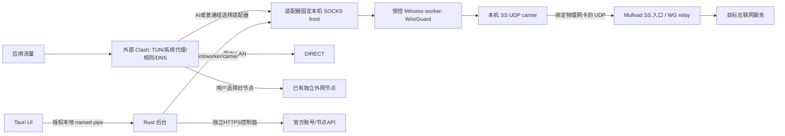

# Windows 部署、网络排障与 Agent 接手

这份文档面向第一次安装的用户，以及在用户自己电脑上继续开发、排查连接问题的 Agent。
不需要原维护者的私人聊天、账号、密钥或私有开发仓库才能开始部署。

**朋友默认只排查并发回文档，不需要编译。**先读[WorkBuddy接手指令](../WORKBUDDY_START_HERE.md)，
按[报告模板](templates/network-report.md)保存本机报告，由用户审阅后私下发回维护者。
需要代码修复时由维护者修改并构建；只有朋友另外明确要求自己开发时才准备下文工具链。

## 先分清：安装使用和编译开发

| 用途 | 要下载什么 | 不需要什么 |
| --- | --- | --- |
| 安装使用 | 完整 Windows x64 `setup.exe`；另装或复用 Clash Verge Rev | Rust、Node、Python、Visual Studio、源码依赖 |
| 读源码、分析已有报告 | 源码 ZIP 和本文；能读本地文件的 Agent | 不必先装完整编译工具链 |
| 改前端/构建前端 | Node/npm，`desktop/package-lock.json` 锁定的依赖 | 不必为单纯前端检查安装 Mac/Ruby/PQ 工具链 |
| 编译完整 Windows 安装器 | Windows x64、Rust/MSVC、Windows SDK、Node/npm、Python 3.11+ | 接收安装包的普通用户不用装这些 |

交接基线安装包为 `MullvadAdapter_0.1.0_windows-x64_setup.exe`，236,585,097 字节，
约 236.6 MB / 225.6 MiB。其编译源码为
`a90c22123c8578871614febee1ce5ee9f4d2db89`，SHA256 为：

```text
00a057df93b4837f3dc045724f8d084a436503adbe98a94279d251f3c6cf3b90
```

该完整包包含界面、独立后台、固定版本 Mihomo、运行时清单，以及 Microsoft
离线 WebView2 安装器。离线 WebView2 会增大安装包；它不是让用户下载开发环境。
联网仍用于账号、节点目录、Clash 规则数据库/供应器等业务，不等于需要在线编译。
Clash 是独立产品，不在这个安装包中静默捆绑安装。

首次开发构建需要下载编译器、SDK、Rust/npm 依赖和打包工具，明显多于一个安装包；
具体容量取决于现有工具和缓存，不承诺一个固定下载量。可以先用成品部署，确认问题
属于配置还是实现后再装工具链。已有锁定缓存可增量编译，不用每次重新下载。

## 十分钟内开始部署

1. 确认 Windows 11 x64。Windows ARM64、Windows 10 和全新缺运行时机器的兼容性
   没有在此交接中承诺。核对 `candidate.json`、本文和交接 `PUBLIC_BASELINE.json` 的源码/摘要。
   在安装器所在目录运行以下 PowerShell，只读取文件：

   ```powershell
   Get-FileHash -LiteralPath '.\MullvadAdapter_0.1.0_windows-x64_setup.exe' -Algorithm SHA256
   ```

2. 这是未做代码签名的测试候选。来源和摘要必须可信；不以关闭系统安全功能解决安装问题。
   正常安装并打开桌面程序。不要从源码目录找一个开发 `.exe` 当完整产品运行。
3. 打开“使用引导”。检测并复用已有 Clash Verge Rev；没有则从
   [官方发行页](https://github.com/clash-verge-rev/clash-verge-rev/releases/latest) 安装并打开一次。
   便携版可在“Clash 接入”填写其真实配置目录。检测失败和没有安装是两种情况。
4. 先准备账号 API 的可用出口。系统 HTTPS 可达就无需另一个节点；受限网络下可用
   本机已有的独立普通代理。它不能最终又指回待建立的 Mullvad 适配器。
   不假设每个人都有同一个 Clash 端口；从本机检测并核对。
5. 在账号页登录已有 Mullvad 账号。账号本身是凭据，不是公钥，不要发到公开 Issue。
   设备列表、名称和地址从官方 API 获取。无身份的新电脑须明确创建并启用自己的设备。
   有旧身份的电脑，不要仅为登录管理而重新创建设备。
6. 设备满额时，先核对具体闲置设备再由用户决定撤销。不要删除仍在其他电脑上使用的
   设备，也不要复制另一台正在运行电脑的私钥。注册超时先核对登记结果，不能盲目重复创建。
7. 保留一至三个常用城市，选一个连接。确认 IP 数据、内层 DNS、HTTPS 状态，而非只看 Ping。
8. 隧道就绪后，在“Clash 接入”点“一键写入 Clash”。程序交给 Clash 官方协议导入一份
   独立配置，不要求手动选文件。已有订阅保留；到 Clash **选用新配置**。
   空客户端首次导入可能自动选中，以客户端读回为准。
9. 在 Clash 自己的界面选择系统代理或 TUN 使用方式。适配器不会自动切换这两个系统设置。
   先验证最小路径，再测试用户原有 TUN 环境，不一上来批量更改网卡、DNS或防火墙。
10. 分别验证普通外网、AI 服务、国内站点，留下不含凭据的结果。国内/LAN 默认直连，
    AI/普通外网默认 Mullvad；两个外网组也可以分别选择原来的独立节点。

已写文件、已发送导入、Clash 已登记、已选中、流量真正从指定出口出去，是五个不同结果。
账号 API 正常也不能证明隧道正常。详细操作保留在 [首次引导](first-use.md)、
[安装与回退](windows-install.md)、[Clash 接入](clash-connect.md)。

## 让排障 Agent 不依赖待测隧道

建议先用能在当地稳定联网、能读文件/执行命令的 Agent。WorkBuddy/CodeBuddy 接
DeepSeek 有[官方说明](https://api-docs.deepseek.com/quick_start/agent_integrations/workbuddy/)；
具体模型名称、服务可达性以使用者的客户端和实际请求为准。品牌或模型不会自动让请求直连。
不要把 Agent 的 API Key 放进项目、交接压缩包或诊断报告。

Codex 也可以排查，但其服务请求应走一条独立可用的出口，不能依赖正在修复的适配器。
本配置 AI 出口默认 Mullvad，**仅把 Agent 归为 AI 流量并没有解决循环依赖**。
若需要例外，让用户本地 Agent 核对实际进程/服务域名，把有限范围规则放在宽泛 AI 规则前，
明确指向一个不经适配器的节点；服务能直连时才用 DIRECT。检查真实规则命中和连接链，
不能只看到 YAML 写了 DIRECT 就宣布绕过了 TUN。不要把整个外网或所有 AI 都临时改直连。

同时保留原来的可用 Clash 配置作为回退。完全断网时任何云模型都可能不可用；先由软件
持续留日志，在本机保存报告，恢复独立网络后再让 Agent 分析。不能靠在线 Agent 代替离线日志。

## 当前连接到底经过什么



外部 Clash 负责系统拦截和业务规则；适配器负责城市、身份、隧道、探测和恢复。
WireGuard 是隧道；SS 是其外层承载/混淆，不是把加密业务取消后直接转发。
front、worker 和外部 Clash 是不同职责，进程数不一定等于“两层”。
Windows 不是使用 Mac 的 Ruby/launchd；它用 Rust 后台和 Tauri/React 界面。
不要拿旧 Mac 固定端口、网卡名、设备名和机器路径到朋友电脑直接使用。

### SS、NAT、MTU 和协议能力边界

| 项目 | 此 Windows 基线的含义 |
| --- | --- |
| SS | 已接入并实测的产品路径是 WireGuard over Shadowsocks，经物理绑定 UDP carrier；不是 TCP 保底 |
| SS 参数 | 地址、公钥、WG/SS 主入口端口范围来自官方目录；公共算法/口令是协议常量，不是用户密码；extra 地址使用明确的 extra 端口策略 |
| 对称 NAT | 不等于必然失败。这是客户端向固定公网服务端主动发包，不是两台内网电脑 P2P 打洞；关键要看出站 UDP、目标回包、映射和丢包 |
| Keepalive | 当前 25 秒，用于维持空闲 NAT 映射；不解决完全封禁 UDP、断 Wi-Fi、账号撤销和错误出口 |
| TCP 控制连接 | carrier 的 SOCKS TCP 控制连接不等于 WireGuard 数据已经套了 TCP；只看到 TCP ESTABLISHED 不能证明 UDP 通 |
| Direct IPv4/IPv6 | 配置生成器存在，产品自动恢复目前不选这些路径。不能把调试 CLI 能生成配置写成 UI 已支持 |
| UDP2TCP/QUIC/LWO | 没有在此产品基线接通；若网络禁 UDP，仅换 SS、加重试或批量 Ping 不能承诺修复 |
| 多跳/PQ/DAITA | Windows 不支持的必需保护会显式拒绝，不会静默降低。Mac/helper 的实现不代表 Windows 已验收 |
| MTU | 这是本地策略，不是官方目录数据。此基线 SS WG 为1265，其他生成路径1280；不要直接升级内核并假定兼容。某些新版内核会拒绝带IPv6地址且MTU<1280的配置，须先隔离测试生成配置和真实路径，不能为让parser通过就宣称大流量/PMTU通过 |

SS 改善部分特征识别或入口可达性，不是所有复杂网络的万能方案。官方客户端不稳不等于
换成此软件一定稳定；要分清本机链路、UDP/SS、WG、DNS、HTTPS和Clash分流是哪一层失败。
数据来源及更多限制见 [通道能力](network-capabilities.md)，协议依据见
[WireGuard NAT 保活](https://www.wireguard.com/quickstart/)。

### 恢复原则与实际限制

- 一个选定城市是自动恢复边界。同城换节点也可能换公网 IP；不承诺固定 IP。
- 物理网卡无链路/无可用地址时暂停，恢复稳定约2秒后先验证原路径，再重建原节点，
  原数据路径失败才考虑同城备选。不因本机离线把所有节点记坏。
- 一套设备密钥不能用并行完整探测去争抢同一 WG peer。候选 ICMP/历史是线索，
  不是所有备用隧道都已热连接。不要为“加速恢复”取消 peer 独占和证据新鲜度守卫。
- Ping 不能证明 WG、内层 DNS、HTTPS 或目标站点可用；完整检查有独立阶段和时间限制。
  慢 HTTPS 使早期证据过期时，会在同一 worker 有界重测，不通过修改时间戳伪造就绪。
- 正常健康检测完成后间隔15秒；45秒是恢复轮允许启动新尝试的预算，不是最长断线时间。
  实际还受探测、系统调用、进程清理影响。不要在文档或 UI 承诺秒切/零中断。
- 已知后续点：物理采样原生调用仍可能长时间挂起；持续仅 DNS 退化尚无专门修复触发；
  原订阅节点全量持续更新未完整接通。修复应保持取消、代次、实例和同城约束。

## 断线时如何留证并分层排查

先记录本地时间、选定城市/节点、网络类型、是否开外部 TUN、故障持续多久。
不要先重装、删状态、换密钥或把全部节点完整测一遍，那会丢失现场或扩大变量。

“网络诊断”生成 JSON 文件并复制**文件路径**到剪贴板。路径指向朋友自己的电脑，
传给另一台电脑的人需要另发经过人工/本地白名单处理的报告文件；仅复制路径不会上传内容。
应用原始JSON包含状态和最近最多200条事件，可能带本机用户目录、设备名称/ID和公钥，
不是完整匿名化文件。按WorkBuddy入口先本机白名单摘录，绝不直接对外发送原始JSON。
该报告也不能替代更早日志。

默认应用状态在 `%LOCALAPPDATA%\MullvadAdapter-Windows\`；事件文件
`events.jsonl` 和 `events.previous.jsonl` 按大小轮转，单个约10 MiB，总约20 MiB，
不是固定只保留一天，也不保证若干天；每次追加可能略过阈值。报告另存为
`report-<id>.json`，不要把报告总目录容量误算成事件日志上限。
不要分享 `store`、完整Clash配置、供应器订阅URL、账号或私钥；DPAPI密文也不要上传。
先让本地工具提取必要字段后交给Agent，不整体回显原始JSON，不收集整个用户目录。

| 观察到的情况 | 首先核对 | 不能直接得出的结论 |
| --- | --- | --- |
| 本机离线/`waiting_network` | 物理网卡状态、地址、路由及恢复时间 | 所有relay失效 |
| 账号/目录 API 超时 | 真实HTTPS出口、引导代理是否指回自身、DNS/TLS | 当前WG密钥一定失效 |
| SS/UDP无回包 | carrier实际本地源/网卡、目标入口和端口、收发计数、网络变化代次 | 对称NAT必然不支持 |
| 有UDP但WG数据不通 | 设备官方登记、公钥匹配、peer独占、最新目录、MTU、握手/内层数据 | Ping通就一定能用 |
| IP数据通、DNS失败 | 隧道内DNS及其TCP观测，是否持续退化 | 应立刻换城市 |
| DNS通、某HTTPS失败 | TLS、目标站点状态和策略；401/403可能是应用层 | 整条隧道崩溃 |
| front通、外部Clash不通 | 已选配置、rule模式、组选择、全局脚本覆盖、真实连接链 | 安装包损坏 |
| 国内网站不通而外网正常 | 国内DIRECT实际路由、Wi-Fi/网关/DNS和TUN拦截 | Mullvad节点就是原因 |
| 恢复卡住 | 操作ID、网络代次、阶段时长、采样/锁等待/cleanup状态 | 可以直接删锁或kill所有mihomo |

真实应用路径验证应先用程序显示的 front 端口做独立 HTTPS 请求，再通过 Clash 显示的
mixed 端口做同类请求并核对规则命中。不要照抄维护者历史端口。若所选外网组为
Mullvad，核对实际出口；如果用户选择自己的节点，出口不同是预期行为。

此产品不是系统级 kill switch。适配器未就绪时其 front 拒绝转发，不会为恢复自动
改DIRECT；但外部Clash本来就有国内/LAN直连规则，系统代理也不是覆盖所有应用的TUN。
全局泄漏范围必须按朋友本机设置验证，不能凭“front拒绝”保证全机永不直连。

禁止 Agent 擅自让电脑睡眠、断网、改电源、关防火墙、重置所有网卡或在工作桌面循环
开关窗口/夺焦点。先只读留证，修改一个变量并保留回滚。破坏性测试用隔离会话/专用机器。

## 给开发 Agent 的源码地图

| 入口 | 负责什么 |
| --- | --- |
| `desktop/src/main.tsx`、`setup-page.tsx`、`clash-page.tsx`、`app-api.ts` | 日常页面、首次引导、Clash接入、类型化请求 |
| `desktop/src-tauri/src/main.rs`、`clash.rs`、`capabilities/` | native命令授权、后台启动/停止、Clash本机集成、剪贴板 |
| `core/crates/agent/src/windows_live.rs`、`live_connection.rs` | Windows长期owner、授权命令、连接/恢复调度 |
| `core/crates/agent/src/live_quick.rs`、`live_diagnostics.rs`、`live_runtime.rs` | 有界Ping维护、日志/报告、payload校验 |
| `core/crates/domain`、`control`、`protocol` | 同城策略、事务/取消/代次、证据/IPC合同和DTO |
| `core/crates/engine-mihomo` | front/worker图、SS carrier、内层DNS/HTTPS canary、promotion gate |
| `core/crates/platform` | Windows IPHelper/网卡路由、物理UDP绑定、Job/进程、SID/ACL/DPAPI和pipe |
| `core/crates/catalogue`、`mullvad-api`、`history` | 官方目录/账号客户端、校验和安全存储、历史排序 |
| `core/crates/clash-integration` | 独立配置/规则、loopback订阅服务、HTTP/pipe控制、旧接入撤销 |
| `engines/mihomo-compatibility.json`、`packaging/windows/` | 固定内核来源与摘要、payload、完整NSIS构建 |
| `.github/workflows/windows-shared-core.yml` | checks → 非发布候选；签名/发布另行授权 |
| `ui/`、`daemon/`、`helpers/pq-negotiator/` | Mac原实现及可选组件参考；不是Windows的现用后台 |

公共协议常量、恢复预算和路由策略不必全部从API获取；应区分策略常量和本机/官方数据。
内核来源清单中的旧 `purpose` 字段仍称parser-only，Windows构建实际上通过
`stage_runtime.py`捆绑它；此历史描述不能当作安装包没有内核的依据。
设备、节点、地址和网卡不能靠开发者样例硬编码。测试fixture和mock命令不代表产品实况。
文件顶部旧的“skeleton/PROPOSED”注释与迁移任务勾选表是历史规划，不能仅据此判定
当前没有实现，也不能反过来当所有目标已验收。以实际命令路由、代码、测试及交接清单为准。

## 需要改代码时再搭建编译环境

在 Windows x64 安装 Git、Python 3.11+、Node 24.19.0（或经验证兼容版本）、
Rust 1.97.1 的 MSVC工具链、Visual Studio C++ Build Tools与Windows SDK。
这是对齐现有完整候选CI的构建基线，不是所有工具的最低版本。核心声明最低Rust1.88，
不代表完整桌面依赖都支持1.88。开发主机需要可下载Cargo/npm/GitHub/打包器依赖的出口。
参考 [Tauri Windows 前置条件](https://v2.tauri.app/start/prerequisites/#windows)。

在源码仓库根目录的 PowerShell 中执行：

```powershell
rustup toolchain install 1.97.1 --profile minimal --component rustfmt
rustup override set 1.97.1
rustup target add x86_64-pc-windows-msvc
cargo fmt --manifest-path core/Cargo.toml --all -- --check
cargo test --manifest-path core/Cargo.toml --locked
Push-Location desktop
npm ci --ignore-scripts
npm run build
Pop-Location
cargo test --manifest-path desktop/src-tauri/Cargo.toml --locked
python packaging/windows/test_build_candidate.py
python packaging/windows/test_stage_runtime.py
```

这些常规检查不用真实账号，不注册设备、不改现用Clash、不做系统断网。
Windows专属或 `ignored` 测试仍要按真实执行结果记录，不把Mac/Linux单测当Windows验收。
不要为加快构建删除锁文件、随意浮动依赖或关TLS校验。

检查通过、源码变更已提交后，构建**新的**输出目录：

```powershell
$sourceSha = (git rev-parse HEAD).Trim()
python packaging/windows/build_candidate.py --source-sha $sourceSha --output C:/build-output/adapter-candidate --target-dir C:/build-cache/adapter-candidate
```

输出目录必须不存在；脚本拒绝覆盖旧包。缓存目录只供一个构建进程使用。
如只拿到无 `.git` 的源码ZIP，先使用交接版本定位公开仓库对应提交，或建立本地版本管理
并提交自己修改后的源码；不要把修改后的程序仍标成原安装包的a90源码。
脚本不自动 `npm ci`，所以不能跳过前面依赖安装。
`--offline` 主要限制Cargo；WebView2/NSIS或内核资源未缓存时仍可能要下载，不是全流程离线承诺。
构建不自动安装、签名或发布。新包必须核对candidate/manifest/真实安装文件，并单独验收。

最初部署直接用已编译成品即可。若网络导致依赖难下载，可在另一台Windows机器/可用CI
编译后只传成品，朋友的运行机器不必变成构建机器。源码和安装包分别提供，避免每次排障
都要传一次几百MB安装器。

## 验收、升级回滚和公开范围

交接的a90包在一台既有Windows11 x64环境已做完整安装/升级、真实账号列表与独立设备、
SS/WG连接、Clash独立配置及普通/AI/国内出口验收；这是基线证据，不是朋友网络已通过。
全新机器/缺WebView2、当前版TUN故障恢复、长期稳定以及高级传输仍不能据此写PASS。
原始 `candidate.json` 中NOT_RUN是打包时字段，保留原件；后续安装证据是另一层，不篡改它。

升级/回滚前正常断开并“停止后台并退出”，确认自有后台退出，保留完整旧安装包和用户
状态，再正常安装。不要覆盖锁住的runtime；不要按进程名杀掉别人的Clash，也不要删除
`%LOCALAPPDATA%\MullvadAdapter-Windows\`。身份存储由本机用户DPAPI保护，不用把另一台
电脑的密文目录复制过来。旧包可能不认识新数据结构，具体降级须核对schema，不能承诺任意降级。

交接包只应含：完整安装器、原始candidate清单、本文、源码快照、第三方来源/许可和摘要。
不含 `.git` 历史、私有 `project-dev-context`、真实账号/私钥、订阅、原始排障报告或机器状态。
源码快照中的文档提交与安装器a90源码分别记录在 `PUBLIC_BASELINE.json`，文档更新不是重新编译。

本公开源码按所有者的开源发布委托采用GPL-3.0-only，保留Mihomo等第三方的许可和源码来源。
Mac PQ helper有其独立上游来源和许可，不代表此Windows包包含它。不得删除第三方通知。
已有私有Git历史不在本源码ZIP审查范围，不能直接把旧仓库改公开当成已脱敏。

## 可直接发给朋友 Agent 的接手指令

> 你负责本机Mullvad Adapter的部署和网络排障。先完整读AGENTS.md、本文、
> docs/network-capabilities.md、docs/clash-connect.md与PUBLIC_BASELINE.json；核对安装包SHA256、
> 实际runtime/manifest.json和源码版本。没有私有开发仓库权限应明确说明，但可以在这份
> 公共交接范围内继续，不能假装已读私人历史。先本机白名单提取应用报告，不整体回显原始JSON；分开
> 物理网络、账号API、SS/UDP、WG、内层DNS、HTTPS、Clash规则/实际出口；不要把Ping
> 当隧道可用，也不要假设官方客户端不稳的原因。保护当前设备密钥、账号和原Clash配置。
> 保证你自己的模型和远控走独立出口；未获明确许可，不睡眠、断网、改电源、删设备或状态、
> 关安全功能，不反复操作用户工作桌面。先解释证据与最小修复，每次只改一个变量，保留
> 回滚。默认不安装开发工具、不改源码、不编译；按模板生成本机Markdown，由用户审阅后
> 发回维护者，由维护者修源码并构建。仅在另有明确开发委托时准备工具链。分别汇报PASS、FAIL、
> NOT_RUN、BLOCKED，标明源码/构建/实装/真实出口，不把模拟、跳过或编译成功当运行验收。
